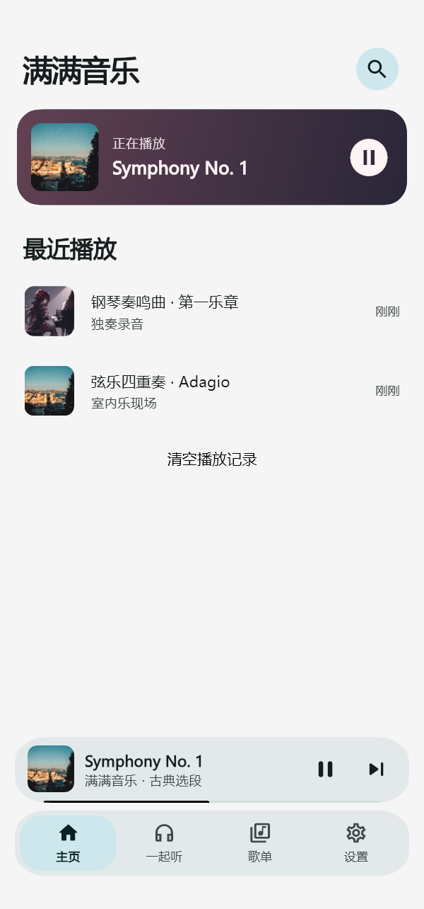
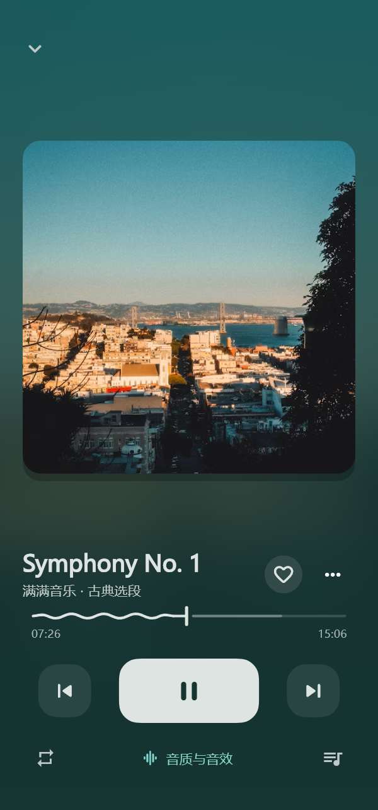

<div align="center">


# 满满音乐 · ManManMusic

**把 B 站的音乐、现场和播客装进播放列表。可以锁屏听，也可以和朋友一起听。**

[下载 Android APK](https://github.com/m-rui001/ManManMusic/releases/latest/download/ManManMusic-universal.apk) · [版本更新](https://github.com/m-rui001/ManManMusic/releases)

</div>

<div align="center">



</div>

## 你可以用它做什么

- **听 B 站音频** · 搜索视频或打开分享链接，后台和锁屏都能播放。视频分 P 和合集可以按顺序连播。
- **把喜欢的内容存起来** · 点红心加入歌单，也可以把 B 站收藏夹导入本地。支持下载和历史播放。
- **和朋友同步听** · 登录后开房，把好友加入名单。好友进房后会同步曲目和进度，也可以授权好友一起换歌。
- **播放可用的最高音质** · 优先尝试账号有权访问的无损音轨，普通音轨按 B 站返回的码率排序。播放器显示当前音轨，网络不可用时可使用本机缓存。

歌单、播放历史和登录凭证保存在本机。一起听通过 [ntfy.sh](https://ntfy.sh/) 的公开中继交换曲目、播放状态和房间成员信息，无需自建服务器。

## 本地运行

使用 Flutter 3.27.x 和 JDK 17。连接 Android 设备后运行以下命令。

```bash
flutter pub get
flutter run
```

Android 安装包由 [GitHub Actions](./.github/workflows/release-android.yaml) 构建。自建签名使用 `KEYSTORE_BASE64` 和 `KEY_PROPERTIES`。覆盖安装需要与旧版本使用相同的签名。

## 上游与许可

项目基于 [bobomusic](https://github.com/Redstone-1/bobomusic)，部分基础功能源自 [bb-music/flutter-app](https://github.com/bb-music/flutter-app)。本仓库新增和修改的代码采用 [MIT](./LICENSE)，上游代码按原有的 [Apache-2.0](./LICENSE-APACHE) 许可发布。
